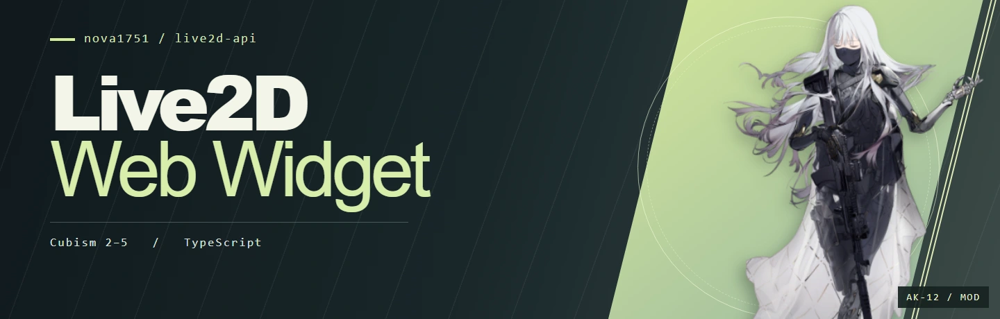
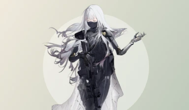
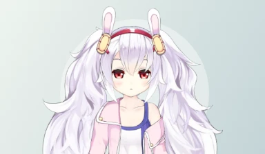
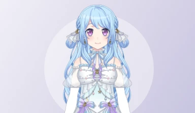
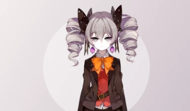
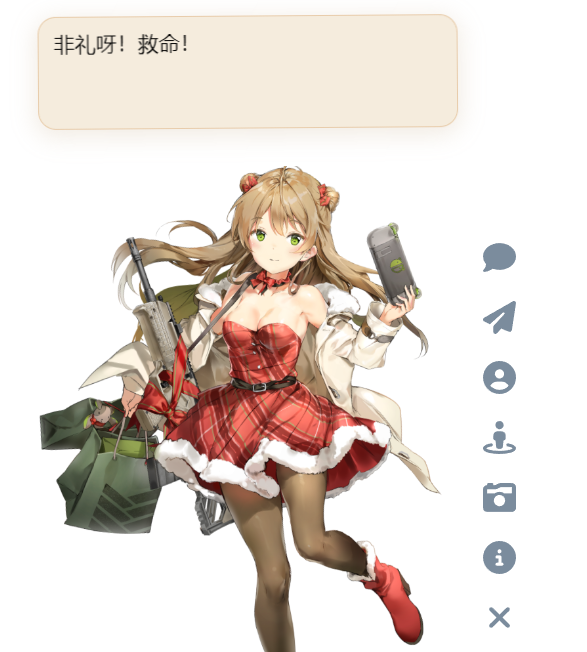
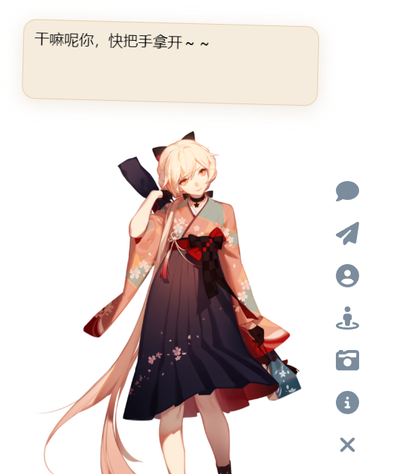

<div align="center">

<a href="https://nova1751.github.io/live2d-api/catalog/?collection=girls-frontline&amp;model=doll/ak12/mod/normal"></a>

# Live2D 网页看板娘

在网站中嵌入可互动的 Live2D 模型。你可以加载自己的模型清单，也可以接入现成图鉴，按人物和造型切换。

<a href="https://www.npmjs.com/package/live2dapi-noa"></a> <a href="https://github.com/nova1751/live2d-api/actions/workflows/publish.yml"></a> <a href="#api-与兼容性"></a> <a href="#素材与致谢"></a>

**[打开在线图鉴](https://nova1751.github.io/live2d-api/catalog/)** · [快速接入](#快速接入) · [模块 API](#api-与兼容性) · [English](https://github.com/nova1751/live2d-api/blob/main/docs/en/README.md)

</div>

## 在线示例

点击一位角色即可进入对应造型，试播动作或放大全屏。

| <a href="https://nova1751.github.io/live2d-api/catalog/?collection=girls-frontline&amp;model=doll/ak12/mod/normal"></a> | <a href="https://nova1751.github.io/live2d-api/catalog/?collection=azur-lane&amp;model=ship/10117/lafei"></a> | <a href="https://nova1751.github.io/live2d-api/catalog/?collection=bang-dream&amp;model=hhw/012/012_dream_festival_4_ur"></a> | <a href="https://nova1751.github.io/live2d-api/catalog/?collection=houkai2&amp;model=character/bronya/bronya"></a> |
| :---: | :---: | :---: | :---: |
| [AK-12 · 心智升级](https://nova1751.github.io/live2d-api/catalog/?collection=girls-frontline&model=doll/ak12/mod/normal) | [拉菲](https://nova1751.github.io/live2d-api/catalog/?collection=azur-lane&model=ship/10117/lafei) | [松原花音](https://nova1751.github.io/live2d-api/catalog/?collection=bang-dream&model=hhw/012/012_dream_festival_4_ur) | [布洛妮娅](https://nova1751.github.io/live2d-api/catalog/?collection=houkai2&model=character/bronya/bronya) |

另外两个可直接操作的示例 · [机动战队 · 斯洛卡伊](https://nova1751.github.io/live2d-api/catalog/?collection=iron-saga&model=character/siluokayi/base) · [战舰少女 R · 密苏里](https://nova1751.github.io/live2d-api/catalog/?collection=warship-girls&model=ship/209/2)

## 快速接入

把下面的代码放在网页的 `</body>` 前。示例使用《机动战队》玛蒂尔达的实机模型，贴图、动作和语音随清单一起加载。

```html
<script type="module">
  import { loadWidget } from "https://cdn.jsdelivr.net/gh/nova1751/live2d-api@widget-latest/widget.mjs";

  await loadWidget({
    modelUrl: "https://cdn.jsdelivr.net/gh/nova1751/live2d-api@cdn-b3ac5ae545e2-assets-5/model/madierda/index.json",
    position: "right",
    locale: "zh-CN",
  });
</script>
```

换自己的角色时，把 `modelUrl` 指向 Cubism 2 的模型 JSON 或 Cubism 3–5 的 `.model3.json`，保留贴图和动作的相对路径。跨域部署需要素材服务器允许 CORS。面向中国大陆时，可以把示例中的两处 `cdn.jsdelivr.net` 都换成 `cdn.jsdmirror.com`。其他作品的素材域名由各自的图鉴目录决定。

## 通过 npm 或 pnpm 安装

```sh
npm install live2dapi-noa
# 或
pnpm add live2dapi-noa
```

在页面挂载后执行。使用服务端渲染的项目，可在客户端生命周期函数中调用。

```ts
import { loadWidget } from 'live2dapi-noa';

await loadWidget({
  modelUrl: '/models/haru/haru.model3.json',
  locale: 'zh-CN',
  position: 'right',
});
```

npm 包包含 JS 播放器、样式、TypeScript 声明和两套界面文案。模型、贴图、动作和录音托管在 GitHub。项目打包器移动入口文件后，组件会从 GitHub CDN 加载同版本的运行文件；可通过 `baseUrl` 指定国内运行时目录或自托管目录。直接通过 CDN 使用模块 API 时，从快捷入口同目录的 `widget.mjs` 导入相同函数即可。

## 使用自己的模型目录

多个模型可以共用一个静态 JSON 目录。为每个造型取一个稳定 ID，`baseUrl` 相对于目录文件解析，`manifest` 相对于该素材源解析。以下示例假定目录放在 `/models/catalog.json`，两份模型位于相邻的子目录。

```json
{
  "schemaVersion": 1,
  "sources": { "local": { "baseUrl": "./" } },
  "models": {
    "haru/original": [{ "source": "local", "manifest": "haru/haru.model3.json" }],
    "companion/original": [{ "source": "local", "manifest": "companion/model.json" }]
  }
}
```

```js
await loadWidget({ catalogUrl: '/models/catalog.json', modelId: 'haru/original' });
```

挂载后，可在自己的选择器中调用 `selectWidgetModel(id)` 切换造型。

## 界面语言与人物台词

组件按需加载渲染器。内置图鉴根据造型的可见轮廓取景。台词气泡位于人物上方，工具栏靠右垂直居中。在较窄的图鉴里，横向造型的工具栏会移到上方。

| 配置位置 | 简体中文（默认） | 英文 |
| --- | --- | --- |
| 快捷入口 | 省略参数或添加 `?lang=zh-CN` | 添加 `?lang=en` |
| 模块 API | `locale: 'zh-CN'` | `locale: 'en'` |
| 在线图鉴 | [中文图鉴](https://nova1751.github.io/live2d-api/catalog/) | [英文图鉴](https://nova1751.github.io/live2d-api/catalog/?lang=en) |

语言设置适用于工具栏、无障碍标签、问候和预设提示。图鉴切换语言时会保留当前造型。游戏台词按动作和语音事件匹配：英文优先读取事件原有字幕，中文按角色和语音编号查找译文。旧模型也支持按语音编号或内嵌原句匹配译文。互动缺少台词时显示所选语言的预设提示。字幕保留到动作和语音结束，两种语言都播放模型原有录音。新版模型会等动作和录音就绪，从动作首帧按模型配置的延迟播放语音。录音缺失或加载失败时，仍会播放动作并显示对应台词。

## 放大与全屏

图鉴人物的手臂、衣摆和特效可以画到原交互框外。伸出的部分会把点击交给下方网页，人物原区域和工具栏照常响应。悬浮看板娘默认层级为 10，可在宿主页用 `:root { --waifu-z-index: 20; }` 调整。

点击工具栏的 **放大查看**。默认的 **100%** 会让人物适应当前窗口。可以拖动滑块，也可以输入 **50–300%** 的整数并按 Enter 确认。放大后可滚动查看细节，点 **适应窗口** 回到 100%。

**全屏** 会保留当前比例，仍可继续调整。点 **还原** 返回网页，人物、动作和语音沿用同一块画布。嵌入 iframe 时，宿主页面需要授予全屏权限。想让自己的页面每次以 150% 打开，可以设置 `loadWidget({ modelUrl, expandedZoom: 150 })`。

## 按作品浏览

图鉴按作品加载，支持按人物或造型搜索、切换和分享。BanG Dream! 还可以按乐队筛选。

点击人物时优先采用模型自带的触摸事件。在没有匹配事件的可见部位，播放器会从该造型已有的动作中随机选择；有多个可选动作时尽量避免连续重复。待机动作和登录等专用事件保留各自的触发方式。

| 作品 | 已收录造型 | 接入范围 |
| --- | ---: | --- |
| 少女前线 | 443 | 保留原入口、旧模型地址和作品内排序 |
| 碧蓝航线 | 178 | 按舰船与装扮归档，依照装扮 ID 和事件键匹配录音与中文台词 |
| BanG Dream! | 2,769 | 九个乐队素材库，按乐队、人物和服装归档 |
| 崩坏学园 2 | 19 | 八重樱两款造型归到同一人物；保留原动作，来源缺录音的事件可静音预览 |
| 机动战队 | 4 | 玛蒂尔达和斯洛卡伊按原声清单播放，另外两位保留原动作。 |
| 战舰少女 R | 3 | 密苏里、大淀和列克星敦（CV-16）的独立换装与动作。 |
| 宝石研物语 | 14 | 按角色归并两作造型，保留清单指定的动作和音频。 |

部署完整静态站后，可从任意网页使用同一模块入口加载指定作品。例如以下文件与网页同源，跨站使用时替换为站点的绝对地址。

```js
import { loadWidget } from '/widget.mjs';

await loadWidget({
  collection: 'azur-lane',
  catalogUrl: '/catalog/games/azur-lane.json',
  modelId: 'ship/10117/lafei',
});
```

各作品使用同名 JSON 目录。模型、贴图与语音保留在固定素材来源；部分作品会访问 GitHub 的原始文件域名。[各图鉴来源与维护说明](https://github.com/nova1751/live2d-api/blob/main/docs/game-catalogs.md)

## API 与兼容性

| 入口或选项 | 用途 |
| --- | --- |
| `loadWidget({ modelUrl, coreUrl })` | 直接加载单个模型。Cubism 2 使用旧版播放器；Cubism 3–5 清单（`.model3.json`）按需加载 `live2d-web` 的 WebGL2 渲染器及 Live2D Cubism Core。 |
| `loadGirlsFrontline(options?)` | 挂载少女前线集合。可设置 `locale`、`modelId`、位置 `position`（`left` 或 `right`）和模式 `mode`（`sequential` 或 `random`）。 |
| `selectWidgetModel(id)` | 挂载后使用稳定 ID 切换角色，可直接从图鉴复制 ID。 |
| `loadModelCatalog(url, collection?, locale?)` | 获取可用 ID、对应语言的名称与原生清单地址。 |
| `baseUrl` / `catalogUrl` / `coreUrl` | 分别指定播放器目录、模型目录 JSON 和 Cubism Core 地址。 |
| 历史调用 | 支持 `initWidget(waifuPath, apiPath)`、数字模型 ID、`autoload.js`、随机或顺序加载器和独立 CSS。 |

<details>
<summary>作品快捷入口、离线预览与历史截图</summary>

## 少女前线一行脚本入口

选择适合主要访客的 CDN，把一行代码放在 `</body>` 前。两个入口都跟随最新稳定版，默认显示简体中文。CDN 缓存更新后，新访问会加载新版本。需要锁定版本时，可将 `widget-latest` 换为 `widget-2.8.0`。

**中国大陆**

```html
<script type="module" src="https://cdn.jsdmirror.com/gh/nova1751/live2d-api@widget-latest/girls-frontline.mjs"></script>
```

**海外**

```html
<script type="module" src="https://cdn.jsdelivr.net/gh/nova1751/live2d-api@widget-latest/girls-frontline.mjs"></script>
```

希望绕过分支缓存、自动采用已发布版本的网站，可使用下面的国内入口。固定地址标识加载脚本自身的版本。它通过国内 npm 镜像查询稳定版本号，再从国内 GitHub CDN 加载对应版本的播放器和模型。查询超时或新版入口暂不可用时，自动使用随脚本发布的版本。海外网站可将域名换成 `cdn.jsdelivr.net`。

```html
<script type="module" src="https://cdn.jsdmirror.com/gh/nova1751/live2d-api@widget-2.4.7/latest.mjs"></script>
```

快捷入口在视口宽度达到 768 CSS 像素时显示。首次访问默认展示一阶空袭妖精，后续访问恢复该站上次选择的造型。需要自定显示条件时可使用模块 API。

## 少女前线示例与离线下载

少女前线分栏收录已核对的公开收藏中 129 个条目、443 个可选形态，包含妖精、人形、副官、小队和背景。标准与战损形态各有独立 ID，7 个旧档 ID 仍指向对应装扮。统计范围和上游缺件记录见核对说明。[模型目录](https://github.com/nova1751/live2d-api/blob/main/catalog/library.json) · [来源与核对记录](https://github.com/nova1751/live2d-api/blob/main/docs/model-library.zh-CN.md)

安装 Node.js 24 和 Git，在仓库根目录运行：

```sh
node scripts/download-models.mts ./models-offline
node scripts/check-model-library.mts ./models-offline
python -m http.server 8765 --bind 127.0.0.1 --directory ./models-offline
```

打开 `http://127.0.0.1:8765/viewer/catalog/`。下载器支持用 `--list` 列出来源、用 `--source dump` 选择单一来源，或用 `--core <文件>` 提供已获授权的 Core 以完全离线预览。

## 原版网页示例

 

</details>

## 开发与发布

使用 Node.js 24 和 `package.json` 固定的 pnpm 版本。修改 `src/` 下的 TypeScript 后，将生成的浏览器文件一起提交。

```sh
pnpm install --frozen-lockfile
pnpm build
pnpm test
pnpm exec playwright-core install chromium-headless-shell
pnpm run test:browser .
```

`pnpm demo` 启动演示站。准备好本地素材后，运行 `node test/library-browser.mts ./models-offline` 验证图鉴和真实模型。发布时推送与包版本对应的 `vX.Y.Z` 标签，CI 验证 tarball，发布固定 GitHub 快照，并通过 OIDC 将同一份已测试播放器发布到 npm。[发布流程](https://github.com/nova1751/live2d-api/blob/main/.github/workflows/publish.yml)

## 素材与致谢

由 nova1751 维护。历史 API 沿用 fghrsh 的协议，界面设计源于 stevenjoezhang 的看板娘组件。项目代码在包清单中声明 ISC；角色模型、录音、Cubism Core 和第三方组件分别适用各自条款。部署素材前请核对来源和再分发授权。[模型来源](https://github.com/nova1751/live2d-api/blob/main/docs/model-sources.json) · [第三方许可](https://github.com/nova1751/live2d-api/blob/main/modern/THIRD_PARTY_NOTICES.md) · [Live2D Core](https://www.live2d.com/en/sdk/download/web/)
