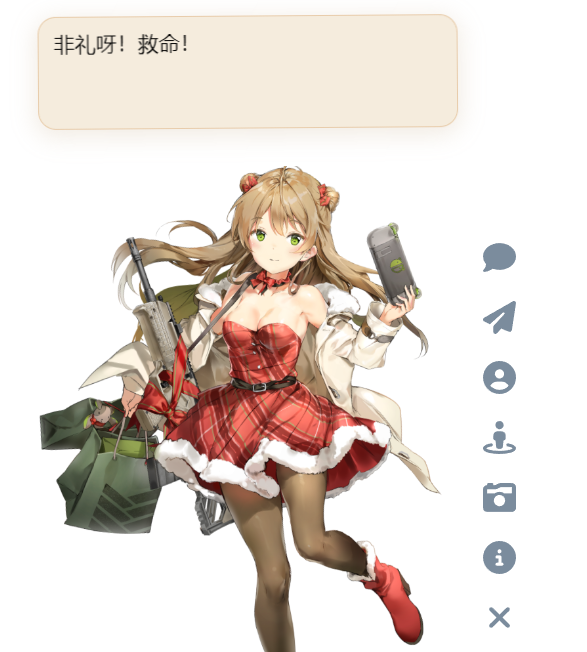
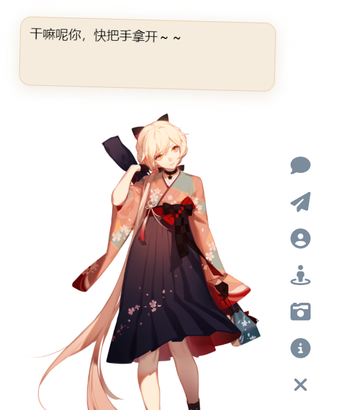

# 少女前线 Live2D 网页看板娘

[English](https://github.com/nova1751/live2d-api/blob/main/README.md) · **简体中文** · [在线图鉴](https://live2d-nova.vercel.app/catalog/) · [npm](https://www.npmjs.com/package/live2dapi-noa)

在网页中加入可互动的少女前线角色。访客可以切换人物和装扮，点击角色时按模型配置播放动作、语音并显示台词。组件按需加载对应渲染器，根据每套造型的可见轮廓调整取景。

## 快速接入

选择适合主要访客的 CDN，把一行代码放在 `</body>` 前。两个入口固定到同一版本，默认显示简体中文。

**中国大陆**

```html
<script type="module" src="https://cdn.jsdmirror.com/gh/nova1751/live2d-api@widget-2.4.0/girls-frontline.mjs"></script>
```

**海外**

```html
<script type="module" src="https://cdn.jsdelivr.net/gh/nova1751/live2d-api@widget-2.4.0/girls-frontline.mjs"></script>
```

快捷入口在视口宽度达到 768 CSS 像素时显示。首次访问默认展示一阶空袭妖精，后续访问恢复该站上次选择的造型。需要自定显示条件时可使用模块 API。

## 通过 npm 或 pnpm 安装

```sh
npm install live2dapi-noa
# 或
pnpm add live2dapi-noa
```

在页面挂载后执行。使用服务端渲染的项目，可在客户端生命周期函数中调用。

```ts
import { loadGirlsFrontline, selectWidgetModel } from 'live2dapi-noa';

await loadGirlsFrontline({ locale: 'zh-CN', position: 'right', modelId: 'doll/k2/3301/normal' });
// 在自己的角色选择器中调用
await selectWidgetModel('doll/56-1type/7706/normal');
```

npm 包包含 JS 播放器、样式、TypeScript 声明和两套界面文案。模型、贴图、动作和录音托管在 GitHub。项目打包器移动入口文件后，组件会从 GitHub CDN 加载同版本的运行文件；可通过 `baseUrl` 指定国内运行时目录或自托管目录。直接通过 CDN 使用模块 API 时，从快捷入口同目录的 `widget.mjs` 导入相同函数即可。

## 界面语言与人物台词

| 配置位置 | 简体中文（默认） | 英文 |
| --- | --- | --- |
| 快捷入口 | 省略参数或添加 `?lang=zh-CN` | 添加 `?lang=en` |
| 模块 API | `locale: 'zh-CN'` | `locale: 'en'` |
| 在线图鉴 | [中文图鉴](https://live2d-nova.vercel.app/catalog/) | [英文图鉴](https://live2d-nova.vercel.app/catalog/?lang=en) |

语言设置适用于工具栏、无障碍标签、问候和预设提示。图鉴切换语言时会保留当前造型。游戏台词按动作和语音事件匹配：英文优先读取事件原有字幕，中文按角色和语音编号查找译文。旧模型也支持按语音编号或内嵌原句匹配译文。互动缺少台词时显示所选语言的预设提示。字幕保留到动作和语音结束，两种语言都播放模型原有录音。

## API 与兼容性

| 入口或选项 | 用途 |
| --- | --- |
| `loadGirlsFrontline(options?)` | 挂载少女前线集合。可设置 `locale`、`modelId`、位置 `position`（`left` 或 `right`）和模式 `mode`（`sequential` 或 `random`）。 |
| `selectWidgetModel(id)` | 挂载后使用稳定 ID 切换角色，可直接从图鉴复制 ID。 |
| `loadModelCatalog(url, 'girls-frontline', locale?)` | 获取可用 ID、对应语言的名称与原生清单地址。 |
| `loadWidget({ modelUrl, coreUrl })` | 直接加载单个模型。Cubism 2 使用旧版播放器；Cubism 3–5 清单（`.model3.json`）按需加载 `live2d-web` 的 WebGL2 渲染器及 Live2D Cubism Core。 |
| `baseUrl` / `catalogUrl` / `coreUrl` | 分别指定播放器目录、模型目录 JSON 和 Cubism Core 地址。 |
| 历史调用 | 支持 `initWidget(waifuPath, apiPath)`、数字模型 ID、`autoload.js`、随机或顺序加载器和独立 CSS。 |

## 模型目录与离线下载

图鉴收录已核对的公开收藏中 129 个条目、443 个可选形态，包含妖精、人形、副官、小队和背景。标准与战损形态各有独立 ID，7 个旧档 ID 仍指向对应装扮。统计范围和上游缺件记录见核对说明。[模型目录](https://github.com/nova1751/live2d-api/blob/main/catalog/library.json) · [来源与核对记录](https://github.com/nova1751/live2d-api/blob/main/docs/model-library.zh-CN.md)

安装 Node.js 24 和 Git，在仓库根目录运行：

```sh
node scripts/download-models.mts ./models-offline
node scripts/check-model-library.mts ./models-offline
python -m http.server 8765 --bind 127.0.0.1 --directory ./models-offline
```

打开 `http://127.0.0.1:8765/viewer/catalog/`。下载器支持用 `--list` 列出来源、用 `--source dump` 选择单一来源，或用 `--core <文件>` 提供已获授权的 Core 以完全离线预览。

## 原版网页示例

 

## 开发与发布

使用 Node.js 24 和 `package.json` 固定的 pnpm 版本。修改 `src/` 下的 TypeScript 后，将生成的浏览器文件一起提交。

```sh
pnpm install --frozen-lockfile
pnpm build
pnpm test
pnpm exec playwright-core install chromium-headless-shell
pnpm run test:browser .
```

`pnpm dev` 启动演示站。准备好本地素材后，运行 `node test/library-browser.mts ./models-offline` 验证图鉴和真实模型。发布时推送与包版本对应的 `vX.Y.Z` 标签，CI 验证 tarball，发布固定 GitHub 快照，并通过 OIDC 将同一份已测试播放器发布到 npm。[发布流程](https://github.com/nova1751/live2d-api/blob/main/.github/workflows/publish.yml)

## 素材与致谢

由 nova1751 维护。历史 API 沿用 fghrsh 的协议，界面设计源于 stevenjoezhang 的看板娘组件。项目代码在包清单中声明 ISC；角色模型、录音、Cubism Core 和第三方组件分别适用各自条款。部署素材前请核对来源和再分发授权。[模型来源](https://github.com/nova1751/live2d-api/blob/main/docs/model-sources.json) · [第三方许可](https://github.com/nova1751/live2d-api/blob/main/modern/THIRD_PARTY_NOTICES.md) · [Live2D Core](https://www.live2d.com/en/sdk/download/web/)
