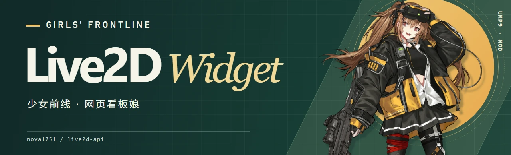
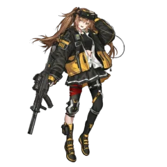
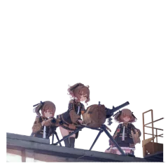

<div align="center">

<a href="https://live2d-nova.vercel.app/catalog/?lang=en"></a>

# Girls’ Frontline Live2D Widget

Add an interactive Girls’ Frontline character to your website with one script. Click a character to play its motions, voice lines and dialogue.

<a href="https://www.npmjs.com/package/live2dapi-noa"></a> <a href="https://github.com/nova1751/live2d-api/actions/workflows/publish.yml"></a> <a href="#api-and-compatibility"></a> <a href="#credits-and-licensing"></a>

**[Open the gallery](https://live2d-nova.vercel.app/catalog/?lang=en)** · [Quick start](#quick-start) · [Module API](#api-and-compatibility) · [简体中文](https://github.com/nova1751/live2d-api/blob/main/README.md)

</div>

## Browse by game

The gallery opens on Girls’ Frontline (443 outfits). Use the game navigation to explore Azur Lane (178 outfits), BanG Dream! (2,769 outfits across nine band archives), or Guns GirlZ (19 outfits). Each has its own search, outfit selector and shareable model links. The three additional collections include manual motion previews. Azur Lane matches audio by skin and event. Guns GirlZ plays silently for events whose referenced recording is missing.

A click first uses the model’s own touch mapping. On an unassigned visible region, the widget samples an eligible motion from that outfit and avoids immediate repeats when alternatives exist. Idle and lifecycle events retain their separate triggers.

On a deployment of the full static site, use the same widget module for all four games. Use absolute deployment URLs when embedding from another origin.

```js
import { loadWidget } from '/widget.mjs';

await loadWidget({
  collection: 'azur-lane',
  catalogUrl: '/catalog/games/azur-lane.json',
  modelId: 'ship/10117/lafei',
  locale: 'en',
});
```

The other catalogs are `bang-dream.json` and `houkai2.json`. Use their filename without the extension for `collection`. The three additional galleries fetch assets from pinned GitHub revisions. Model data stays outside the npm package. [Sources and catalog maintenance](https://github.com/nova1751/live2d-api/blob/main/docs/game-catalogs.md)

## Quick start

Place one module script before `</body>`. Choose the CDN closest to your audience. Both examples select English and follow the latest stable release once the CDN cache refreshes. To pin a release, replace `widget-latest` with `widget-2.4.4`.

**Global**

```html
<script type="module" src="https://cdn.jsdelivr.net/gh/nova1751/live2d-api@widget-latest/girls-frontline.mjs?lang=en"></script>
```

**Mainland China**

```html
<script type="module" src="https://cdn.jsdmirror.com/gh/nova1751/live2d-api@widget-latest/girls-frontline.mjs?lang=en"></script>
```

To follow published releases independently of Git branch caches, use the bootstrap below. Its fixed URL identifies the bootstrap itself. It looks up the stable version in the npm registry and loads that release from the GitHub CDN. If the lookup times out or the new module is unavailable, it falls back to its own release. For mainland China, use `cdn.jsdmirror.com` to select the mainland registry mirror and CDN.

```html
<script type="module" src="https://cdn.jsdelivr.net/gh/nova1751/live2d-api@widget-2.4.7/latest.mjs?lang=en"></script>
```

The shortcut displays the widget on viewports at least 768 CSS pixels wide. A first visit starts with the tier-one Airstrike Fairy. Subsequent visits restore the last outfit on that site. Use the module API to set your own display rules.

## Install with npm or pnpm

```sh
npm install live2dapi-noa
# or
pnpm add live2dapi-noa
```

Run this in the browser after mounting your page. In a server-rendered app, call it from a client-side lifecycle hook.

```ts
import { loadGirlsFrontline, selectWidgetModel } from 'live2dapi-noa';

await loadGirlsFrontline({ locale: 'en', position: 'right', modelId: 'doll/k2/3301/normal' });
// Call from your character picker:
await selectWidgetModel('doll/56-1type/7706/normal');
```

The package includes the JS runtime, styles, TypeScript declarations and both sets of UI messages. Models, textures, motions and recordings are hosted on GitHub. When a bundler relocates the entry, the runtime loads its matching GitHub CDN release. Set `baseUrl` to the mainland runtime directory or to your own deployed copy. For a CDN-only module integration, import the same functions from `widget.mjs` next to the shortcut.

## Languages and dialogue

The widget loads the renderer each model needs and fits the canvas to the visible figure. Captions sit above the figure and the toolbar sits to its right. In narrow gallery panels, wide formations have their tools above them.

| Setting | Simplified Chinese (default) | English |
| --- | --- | --- |
| Shortcut URL | Omit the query or use `?lang=zh-CN` | `?lang=en` |
| Module API | `locale: 'zh-CN'` | `locale: 'en'` |
| Gallery | [中文图鉴](https://live2d-nova.vercel.app/catalog/) | [English gallery](https://live2d-nova.vercel.app/catalog/?lang=en) |

The locale controls widget buttons, accessibility labels, greetings and fallback messages. The gallery language switch preserves the selected outfit. For game dialogue, English uses the subtitle attached to the original motion and voice event. Chinese uses the character and voice key to find the translated line. Older models also use matched voice keys or translations of embedded text. An interaction without a line uses a localized widget hint. Captions stay visible until the action and audio finish. Both languages play the original recording. For modern models, the player waits for the motion and recording, then schedules the voice from the first motion frame using the configured delay. If a recording is missing or fails to load, the motion and its caption still play.

## API and compatibility

| Entry or option | Usage |
| --- | --- |
| `loadGirlsFrontline(options?)` | Mount the collection. Set `locale`, `modelId`, `position` (`left` or `right`) or `mode` (`sequential` or `random`). |
| `selectWidgetModel(id)` | Switch by stable ID after mounting. Copy an ID from the gallery. |
| `loadModelCatalog(url, 'girls-frontline', locale?)` | Read available IDs, localized labels and native manifest URLs. |
| `loadWidget({ modelUrl, coreUrl })` | Render an individual model. Cubism 2 uses the legacy renderer. Cubism 3–5 manifests (`.model3.json`) load the WebGL2 backend from `live2d-web` and Live2D Cubism Core on demand. |
| `baseUrl` / `catalogUrl` / `coreUrl` | Override the runtime directory, catalog JSON URL or Cubism Core URL independently. |
| Legacy integrations | Existing `initWidget(waifuPath, apiPath)`, numeric model IDs, `autoload.js`, random/sequential loaders and standalone CSS remain available. |

## Collection and offline use

| <a href="https://live2d-nova.vercel.app/catalog/?model=fairy/air_attack/1/default&amp;lang=en"></a> | <a href="https://live2d-nova.vercel.app/catalog/?model=doll/ump9/mod/normal&amp;lang=en"></a> | <a href="https://live2d-nova.vercel.app/catalog/?model=squad/ags-30/base/default&amp;lang=en"></a> |
| :---: | :---: | :---: |
| [Airstrike Fairy](https://live2d-nova.vercel.app/catalog/?model=fairy/air_attack/1/default&lang=en) | [UMP9 MOD](https://live2d-nova.vercel.app/catalog/?model=doll/ump9/mod/normal&lang=en) | [AGS-30](https://live2d-nova.vercel.app/catalog/?model=squad/ags-30/base/default&lang=en) |

The gallery lists 443 selectable forms across 129 entries from the audited public collections. It includes fairies, dolls, adjutants, squads and backgrounds. Standard and damaged variants have distinct IDs. Seven older IDs resolve to matching outfits. These counts describe the indexed sources. [Model catalog](https://github.com/nova1751/live2d-api/blob/main/catalog/library.json) · [Source audit](https://github.com/nova1751/live2d-api/blob/main/docs/model-library.zh-CN.md)

From a repository checkout with Node.js 24 and Git, run:

```sh
node scripts/download-models.mts ./models-offline
node scripts/check-model-library.mts ./models-offline
python -m http.server 8765 --bind 127.0.0.1 --directory ./models-offline
```

Open `http://127.0.0.1:8765/viewer/catalog/?lang=en`. Use `--list` to inspect sources, `--source dump` to download a single source, or `--core <file>` to supply your licensed Core for offline rendering.

## Original widget examples

 

## Development and releases

Use Node.js 24 and the pnpm version pinned in `package.json`. Edit TypeScript under `src/` and commit the generated browser files.

```sh
pnpm install --frozen-lockfile
pnpm build
pnpm test
pnpm exec playwright-core install chromium-headless-shell
pnpm run test:browser .
```

`pnpm dev` serves the demo. Run `node test/library-browser.mts ./models-offline` to exercise the gallery against a local collection. For releases, a matching `vX.Y.Z` Git tag triggers CI to verify the tarball, publish fixed GitHub snapshots and publish the tested runtime to npm using OIDC. [Release workflow](https://github.com/nova1751/live2d-api/blob/main/.github/workflows/publish.yml)

## Credits and licensing

Maintained by nova1751. The historical API follows fghrsh’s protocol and the companion UI builds on stevenjoezhang’s widget. The package declares ISC for the project code. Models, audio, Cubism Core and bundled third-party code have their own terms. Check the source and redistribution rights for assets you deploy. [Model sources](https://github.com/nova1751/live2d-api/blob/main/docs/model-sources.json) · [Third-party notices](https://github.com/nova1751/live2d-api/blob/main/modern/THIRD_PARTY_NOTICES.md) · [Live2D Core](https://www.live2d.com/en/sdk/download/web/)
