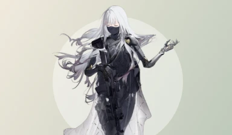
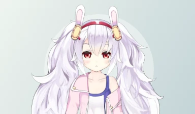
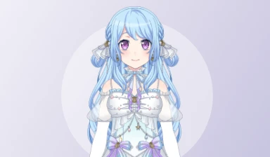
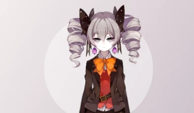

<div align="center">

<a href="https://live2d-nova.vercel.app/catalog/?collection=girls-frontline&amp;model=doll/ak12/mod/normal&amp;lang=en"></a>

# Live2D Web Widget

Embed an interactive Live2D model on your website. Load your own model manifest or connect a catalog with character and outfit selection.

<a href="https://www.npmjs.com/package/live2dapi-noa"></a> <a href="https://github.com/nova1751/live2d-api/actions/workflows/publish.yml"></a> <a href="#api-and-compatibility"></a> <a href="#credits-and-licensing"></a>

**[Open the gallery](https://live2d-nova.vercel.app/catalog/?lang=en)** · [Quick start](#quick-start) · [Module API](#api-and-compatibility) · [简体中文](https://github.com/nova1751/live2d-api/blob/main/README.md)

</div>

## Live examples

Select a character to open that outfit, try a motion or switch to full screen.

| <a href="https://live2d-nova.vercel.app/catalog/?collection=girls-frontline&amp;model=doll/ak12/mod/normal&amp;lang=en"></a> | <a href="https://live2d-nova.vercel.app/catalog/?collection=azur-lane&amp;model=ship/10117/lafei&amp;lang=en"></a> | <a href="https://live2d-nova.vercel.app/catalog/?collection=bang-dream&amp;model=hhw/012/012_dream_festival_4_ur&amp;lang=en"></a> | <a href="https://live2d-nova.vercel.app/catalog/?collection=houkai2&amp;model=character/bronya/bronya&amp;lang=en"></a> |
| :---: | :---: | :---: | :---: |
| [AK-12 MOD](https://live2d-nova.vercel.app/catalog/?collection=girls-frontline&model=doll/ak12/mod/normal&lang=en) | [Laffey](https://live2d-nova.vercel.app/catalog/?collection=azur-lane&model=ship/10117/lafei&lang=en) | [Kanon Matsubara](https://live2d-nova.vercel.app/catalog/?collection=bang-dream&model=hhw/012/012_dream_festival_4_ur&lang=en) | [Bronya](https://live2d-nova.vercel.app/catalog/?collection=houkai2&model=character/bronya/bronya&lang=en) |

Two more playable examples · [Iron Saga · Slokai](https://live2d-nova.vercel.app/catalog/?collection=iron-saga&model=character/siluokayi/base&lang=en) · [Warship Girls R · Missouri](https://live2d-nova.vercel.app/catalog/?collection=warship-girls&model=ship/209/2&lang=en)

## Quick start

Paste this before the closing `</body>` tag. The example loads Matilda from Iron Saga, with textures, motions and voice lines referenced by her manifest.

```html
<script type="module">
  import { loadWidget } from "https://cdn.jsdelivr.net/gh/nova1751/live2d-api@widget-latest/widget.mjs";

  await loadWidget({
    modelUrl: "https://cdn.jsdelivr.net/gh/nova1751/live2d-api@cdn-b3ac5ae545e2-assets-5/model/madierda/index.json",
    position: "right",
    locale: "en",
  });
</script>
```

To use your own character, set `modelUrl` to a Cubism 2 manifest or a Cubism 3–5 `.model3.json`. Preserve relative asset paths and enable CORS on cross-origin hosts. For visitors in mainland China, replace both occurrences of `cdn.jsdelivr.net` with `cdn.jsdmirror.com`. Other galleries use the asset hosts specified in their catalogs.

## Install with npm or pnpm

```sh
npm install live2dapi-noa
# or
pnpm add live2dapi-noa
```

Run this in the browser after mounting your page. In a server-rendered app, call it from a client-side lifecycle hook.

```ts
import { loadWidget } from 'live2dapi-noa';

await loadWidget({
  modelUrl: '/models/haru/haru.model3.json',
  locale: 'en',
  position: 'right',
});
```

The package includes the JS runtime, styles, TypeScript declarations and both sets of UI messages. Models, textures, motions and recordings are hosted on GitHub. When a bundler relocates the entry, the runtime loads its matching GitHub CDN release. Set `baseUrl` to the mainland runtime directory or to your own deployed copy. For a CDN-only module integration, import the same functions from `widget.mjs` next to the shortcut.

## Bring your own catalog

Give each outfit a stable ID in a static JSON catalog. The source base URL resolves against the catalog URL, and manifest paths resolve against that source. In this example, save the catalog at `/models/catalog.json` alongside two model folders.

```json
{
  "schemaVersion": 1,
  "sources": { "local": { "baseUrl": "./" } },
  "models": {
    "haru/original": [{ "source": "local", "manifest": "haru/haru.model3.json" }],
    "companion/original": [{ "source": "local", "manifest": "companion/model.json" }]
  }
}
```

```js
await loadWidget({ catalogUrl: '/models/catalog.json', modelId: 'haru/original' });
```

After mounting, call `selectWidgetModel(id)` from your own outfit selector.

## Languages and dialogue

The widget loads the renderer for each model format. The included galleries fit the canvas to the visible figure. Captions sit above the figure and the toolbar sits to its right. In narrow gallery panels, wide formations have their tools above them.

| Setting | Simplified Chinese (default) | English |
| --- | --- | --- |
| Shortcut URL | Omit the query or use `?lang=zh-CN` | `?lang=en` |
| Module API | `locale: 'zh-CN'` | `locale: 'en'` |
| Gallery | [中文图鉴](https://live2d-nova.vercel.app/catalog/) | [English gallery](https://live2d-nova.vercel.app/catalog/?lang=en) |

The locale controls widget buttons, accessibility labels, greetings and fallback messages. The gallery language switch preserves the selected outfit. For game dialogue, English uses the subtitle attached to the original motion and voice event. Chinese uses the character and voice key to find the translated line. Older models also use matched voice keys or translations of embedded text. An interaction without a line uses a localized widget hint. Captions stay visible until the action and audio finish. Both languages play the original recording. For modern models, the player waits for the motion and recording, then schedules the voice from the first motion frame using the configured delay. If a recording is missing or fails to load, the motion and its caption still play.

## Expanded view

Choose **Expand model** in the toolbar. **100%** fits the character to the current view. Drag the slider, or enter a whole percentage from **50 to 300** and press Enter. Scroll to inspect details at higher zoom and choose **Fit to view** to return to 100%.

**Fullscreen** keeps the selected percentage and zoom controls. **Restore** returns the same canvas to the page with its current character and playback. An embedding iframe needs fullscreen permission from its host. To open at 150% each time, set `loadWidget({ modelUrl, expandedZoom: 150 })`.

## Browse by game

The gallery loads one collection at a time. Search by character or outfit and share a link to the current form. BanG Dream! also supports filtering by band.

A click first uses the model’s own touch mapping. On an unassigned visible region, the widget samples an eligible motion from that outfit and avoids immediate repeats when alternatives exist. Idle and lifecycle events retain their separate triggers.

On a deployment of the full static site, use the same widget module for all four games. Use absolute deployment URLs when embedding from another origin.

```js
import { loadWidget } from '/widget.mjs';

await loadWidget({
  collection: 'azur-lane',
  catalogUrl: '/catalog/games/azur-lane.json',
  modelId: 'ship/10117/lafei',
  locale: 'en',
});
```

Each additional collection uses a JSON catalog with the same name. Models, textures and recordings use pinned sources, including GitHub raw hosts for some games. [Gallery sources and maintenance](https://github.com/nova1751/live2d-api/blob/main/docs/game-catalogs.md)

## API and compatibility

| Entry or option | Usage |
| --- | --- |
| `loadWidget({ modelUrl, coreUrl })` | Render an individual model. Cubism 2 uses the legacy renderer. Cubism 3–5 manifests (`.model3.json`) load the WebGL2 backend from `live2d-web` and Live2D Cubism Core on demand. |
| `loadGirlsFrontline(options?)` | Mount the collection. Set `locale`, `modelId`, `position` (`left` or `right`) or `mode` (`sequential` or `random`). |
| `selectWidgetModel(id)` | Switch by stable ID after mounting. Copy an ID from the gallery. |
| `loadModelCatalog(url, collection?, locale?)` | Read available IDs, localized labels and native manifest URLs. |
| `baseUrl` / `catalogUrl` / `coreUrl` | Override the runtime directory, catalog JSON URL or Cubism Core URL independently. |
| Legacy integrations | Existing `initWidget(waifuPath, apiPath)`, numeric model IDs, `autoload.js`, random/sequential loaders and standalone CSS remain available. |
| Iron Saga | 4 | Matilda and Slokai use their voiced manifests. The other pilots retain their original motions. |
| Warship Girls R | 3 | Individual outfits and motions for Missouri, Ōyodo and Lexington (CV-16). |
| Baoshi Yanwuyu | 14 | Characters and forms from the first two games, with original motion and audio references. |

<details>
<summary>Collection shortcuts, offline previews and original screenshots</summary>

## One-script Girls’ Frontline preset

Place one module script before `</body>`. Choose the CDN closest to your audience. Both examples select English and follow the latest stable release once the CDN cache refreshes. To pin a release, replace `widget-latest` with `widget-2.8.0`.

**Global**

```html
<script type="module" src="https://cdn.jsdelivr.net/gh/nova1751/live2d-api@widget-latest/girls-frontline.mjs?lang=en"></script>
```

**Mainland China**

```html
<script type="module" src="https://cdn.jsdmirror.com/gh/nova1751/live2d-api@widget-latest/girls-frontline.mjs?lang=en"></script>
```

To follow published releases independently of Git branch caches, use the bootstrap below. Its fixed URL identifies the bootstrap itself. It looks up the stable version in the npm registry and loads that release from the GitHub CDN. If the lookup times out or the new module is unavailable, it falls back to its own release. For mainland China, use `cdn.jsdmirror.com` to select the mainland registry mirror and CDN.

```html
<script type="module" src="https://cdn.jsdelivr.net/gh/nova1751/live2d-api@widget-2.4.7/latest.mjs?lang=en"></script>
```

The shortcut displays the widget on viewports at least 768 CSS pixels wide. A first visit starts with the tier-one Airstrike Fairy. Subsequent visits restore the last outfit on that site. Use the module API to set your own display rules.

## Girls’ Frontline examples and offline use

The Girls’ Frontline gallery lists 443 selectable forms across 129 entries from the audited public collections. It includes fairies, dolls, adjutants, squads and backgrounds. Standard and damaged variants have distinct IDs. Seven older IDs resolve to matching outfits. These counts describe the indexed sources. [Model catalog](https://github.com/nova1751/live2d-api/blob/main/catalog/library.json) · [Source audit](https://github.com/nova1751/live2d-api/blob/main/docs/model-library.zh-CN.md)

From a repository checkout with Node.js 24 and Git, run:

```sh
node scripts/download-models.mts ./models-offline
node scripts/check-model-library.mts ./models-offline
python -m http.server 8765 --bind 127.0.0.1 --directory ./models-offline
```

Open `http://127.0.0.1:8765/viewer/catalog/?lang=en`. Use `--list` to inspect sources, `--source dump` to download a single source, or `--core <file>` to supply your licensed Core for offline rendering.

## Original widget examples

 

</details>

## Development and releases

Use Node.js 24 and the pnpm version pinned in `package.json`. Edit TypeScript under `src/` and commit the generated browser files.

```sh
pnpm install --frozen-lockfile
pnpm build
pnpm test
pnpm exec playwright-core install chromium-headless-shell
pnpm run test:browser .
```

`pnpm demo` serves the demo. Run `node test/library-browser.mts ./models-offline` to exercise the gallery against a local collection. For releases, a matching `vX.Y.Z` Git tag triggers CI to verify the tarball, publish fixed GitHub snapshots and publish the tested runtime to npm using OIDC. [Release workflow](https://github.com/nova1751/live2d-api/blob/main/.github/workflows/publish.yml)

## Credits and licensing

Maintained by nova1751. The historical API follows fghrsh’s protocol and the companion UI builds on stevenjoezhang’s widget. The package declares ISC for the project code. Models, audio, Cubism Core and bundled third-party code have their own terms. Check the source and redistribution rights for assets you deploy. [Model sources](https://github.com/nova1751/live2d-api/blob/main/docs/model-sources.json) · [Third-party notices](https://github.com/nova1751/live2d-api/blob/main/modern/THIRD_PARTY_NOTICES.md) · [Live2D Core](https://www.live2d.com/en/sdk/download/web/)
