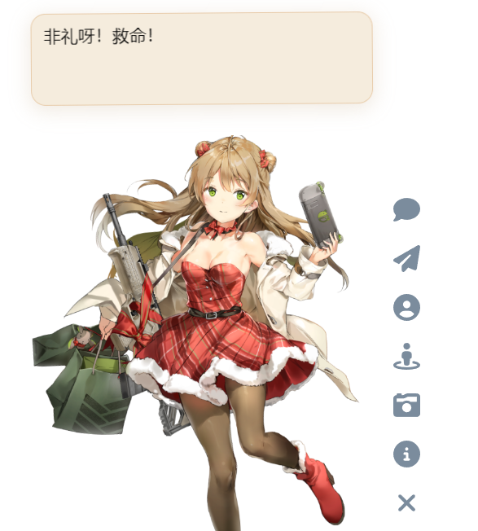
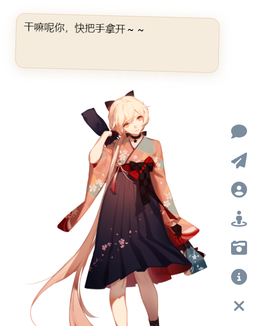

# Live2D_API

> 个人自建的`live2d API`，用于网页端引入看板娘。

## 前言 To start with

- 本项目 API 搭建方式参考自 [fghrsh/live2d_api](https://github.com/fghrsh/live2d_api)。
- 本项目代码参考自 [stevenjoezhang/live2d-widget](https://github.com/stevenjoezhang/live2d-widget)。
- 本项目模型来自 [Eikanya/Live2d-model](https://github.com/Eikanya/Live2d-model)，仅供学习交流，请勿用于商业用途，如有侵权，请联系删除。

## 特性 Feature

1. 将 Live2D API 完全 cdn 化，目录结构简单，便于编辑、添加和删除模型。
2. 为以 CDN 方式加载的 Live2D 模型，添加模型皮肤顺序切换的功能。
3. 将项目配置文件拆分成`<script>`与`<link>`标签的形式便于网站引入。

   

## 使用 How to use

### 一行 CDN 接入

按访客所在地区选一段放到页面的 `<head>` 中。以下两种入口使用同一份模型和播放器。升级时一起更换脚本与资源版本。

**中国大陆 · JSDMirror**

```html
<script defer src="https://cdn.jsdmirror.com/gh/nova1751/live2d-api@cdn-9d81af00062a/autoload.js"></script>
```

**海外 · jsDelivr**

```html
<script defer src="https://cdn.jsdelivr.net/gh/nova1751/live2d-api@cdn-9d81af00062a/autoload.js"></script>
```

入口会加载同一版本的样式、渲染器和模型，初次执行时视口小于 768px 会跳过加载。可以在同一个脚本标签上设置这两个属性。

| 属性 | 可选值 | 默认值 |
| --- | --- | --- |
| `data-position` | `left`、`right` | `left` |
| `data-mode` | `sequential`（顺序换装）、`random`（随机换装） | `sequential` |

**通过 npm CDN 接入**　可使用已发布的 `live2dapi-noa@1.1.0` 的 UNPKG 地址。仅在准备升级时修改版本号。[UNPKG 使用说明](https://unpkg.com/)

```html
<script defer src="https://unpkg.com/live2dapi-noa@1.1.0/autoload.js" data-position="right" data-mode="random"></script>
```

完整仓库超出 jsDelivr 每版本 50 MB 的限制，整库地址在镜像缓存未命中时可能返回 403。大陆示例将播放器、目录和每套皮肤配置放在一个固定版本，动作、模型、贴图和语音由同域名的七个固定版本提供，每份均小于 38 MB。[jsDelivr 大小限制](https://github.com/jsdelivr/jsdelivr#restrictions) · [JSDMirror 说明](https://github.com/jsdmirror/JSDMirror)

[打开 Vercel 在线演示](https://live2d-nova.vercel.app/) · [GitHub Pages 镜像](https://nova1751.github.io/live2d-api/)

### 自有 CDN 和模块调用

面向大陆长期运行的站点，可以把同一份发布包部署到自己的静态站点或国内 CDN。在仓库运行 `pnpm install --frozen-lockfile` 和 `npm pack`，将生成的 `.tgz` 解压，把其中 `package/` 下的文件原样上传到一个版本目录，例如 `/live2d/1.1.0/`。跨域部署时，静态服务器需要允许页面读取资源（CORS），并为 `.js` 和 `.mjs` 返回 JavaScript MIME 类型。版本目录可以设置长缓存，升级时切换入口 URL。

```html
<script defer src="/live2d/1.1.0/autoload.js" data-position="right"></script>
```

需要按页面或用户操作控制加载时，可以直接使用 ES 模块：

```html
<script type="module">
  import { loadWidget } from "/live2d/1.1.0/widget.mjs";
  await loadWidget({ position: "right", mode: "random" });
</script>
```

`loadWidget()` 在组件初始化后完成，模型和纹理随后异步加载。模块调用方自行决定是否在小屏幕加载。同一页面重复或并发调用只初始化一次，以第一次调用的配置为准。加载入口依赖失败时 Promise 会拒绝，可以再次调用。打包工具中可从 `live2dapi-noa` 导入 `loadWidget`，并传入 `baseUrl: "/live2d/1.1.0/"` 指向已部署的完整静态资源目录。

### 兼容旧接入

已使用下面方式的网站可以继续使用原引用。每组示例中，脚本按切换方式二选一，样式按位置二选一。

1. 使用`jsdelivr`引入。

   ```html
   <!-- 顺序切换模型材质 -->
   <script src="https://cdn.jsdelivr.net/gh/nova1751/live2d-api@cdn-9d81af00062a/jsdelivr/sequential/autoload.min.js"></script>
   <!-- 随机切换模型材质 -->
   <script src="https://cdn.jsdelivr.net/gh/nova1751/live2d-api@cdn-9d81af00062a/jsdelivr/random/autoload.min.js"></script>

   <!-- 看板娘位置靠左 -->
   <link
     rel="stylesheet"
     href="https://cdn.jsdelivr.net/gh/nova1751/live2d-api@cdn-9d81af00062a/css/left.min.css"
   />
   <!-- 看板娘位置靠右 -->
   <link
     rel="stylesheet"
     href="https://cdn.jsdelivr.net/gh/nova1751/live2d-api@cdn-9d81af00062a/css/right.min.css"
   />
   ```

2. 使用 UNPKG 引入。

   ```html
   <!-- 顺序切换模型材质 -->
   <script src="https://unpkg.com/live2dapi-noa@latest/npm/sequential/autoload.js"></script>
   <!-- 随机切换模型材质 -->
   <script src="https://unpkg.com/live2dapi-noa@latest/npm/random/autoload.js"></script>

   <!-- 看板娘位置靠左 -->
   <link
     rel="stylesheet"
     href="https://unpkg.com/live2dapi-noa@latest/css/left.css"
   />
   <!-- 看板娘位置靠右 -->
   <link
     rel="stylesheet"
     href="https://unpkg.com/live2dapi-noa@latest/css/right.css"
   />
   ```

> 你可以下载下来`js`和`css`文件来进行自定义配置，详细请参考 [ live2d-widget 配置](https://github.com/stevenjoezhang/live2d-widget#%E9%85%8D%E7%BD%AE-configuration)。

## 本地开发

使用 Node.js 22 或 24，以及 `package.json` 固定的 pnpm 10.33.0。首次使用可执行 `npm install --global pnpm@10.33.0`。在仓库根目录执行 `pnpm install --frozen-lockfile`，再运行 `pnpm dev`。打开终端打印的地址即可预览示例页；修改 TypeScript 后会自动重新构建，刷新页面即可查看。

| 命令 | 用途 |
| --- | --- |
| `pnpm run typecheck` | 严格检查项目 TypeScript 类型 |
| `pnpm run build` | 检查类型，生成浏览器脚本和 npm 的类型声明 |
| `pnpm test` | 验证新旧入口、模型目录、资源路径大小写和 Cubism 2 物理配置 |
| `pnpm run test:browser` | 启动示例页，在 Chromium 中检查 WebGL 绘制和换装；首次运行先执行 `pnpm exec playwright-core install chromium-headless-shell` |

业务代码在 `src/`。`widget.mts` 导出 `loadWidget` 和 `WidgetOptions`；`runtime/` 管理模型、提示和工具栏；`legacy-autoload.ts` 生成四个历史加载入口。修改源码后提交构建产物，以便 jsDelivr 可以直接读取 Git 提交中的脚本。CSS、模型、Cubism 渲染器和小游戏仍在原来的资源路径。

### 维护模型

首次打开网页时，皮肤会播放自己的待机动作。即使上游给待机动作配置了录音，网页也保持静音。主动打开看板娘或切换模型、服装时，播放器只抽选一次该皮肤的 `start` 事件。有登场语音且浏览器允许播放时，语音随登场动作开始。当前目录中有 5 套皮肤配置了 `start`。这是网页的播放策略，ViewerEX 原生的 `start` 在模型载入时触发。[ViewerEX 事件定义](https://live2d.pavostudio.com/doc/zh-cn/live2d/model-config/)

点击按皮肤自己的命中区域选取动作。三套战舰少女模型还使用各自的点击、抚摸或上划规则。仅提供无名动作组的皮肤在网页上以点击触发该组。只配置了语音的事件可以单独播放。配有录音和动作的事件等两项资源均就绪后在同一渲染帧启动，并按音频时钟推进动作。缺少任一已配置资源时跳过该次互动，再次点击可以重试。

`model_list.json` 中的分组和皮肤顺序对应浏览器保存的数字 ID。新增皮肤时追加到对应组末尾。每套皮肤的入口为 `model/<皮肤目录>/index.json`。来源清单记录了每套皮肤对应的上游配置和缺失文件。提交前运行 `pnpm test` 检查发布包中的路径。需要对照上游时，在仓库根目录执行 `node scripts/check-model-sources.mjs <本地上游仓库路径>`，上游应检出清单中记录的提交。[来源与缺失文件](docs/model-sources.json)

- 辛西娅的上游配置使用 A1–A4，实际模型的区域名是 A、B、C1、C2。尚未找到能证实这四组对应关系的配置。该皮肤保留原有网页行为，点击身体会从五个原动作中抽选。
- 玛蒂尔达恢复了 10 个按同角色动作编号对应的录音文件。斯洛卡伊默认配置引用的 11 个录音文件在该套上游资源中缺失，保留原动作和文字。索米和 DSR-50 的三套破损皮肤合计缺少 4 个动作引用。战舰少女配置中的占位音效 `test` 已忽略。
- 斯洛卡伊的日语配置位于 `model/siluokayi/model.model-Japanese.json`。其中 10 段录音按台词从仓库历史恢复，保留原始 MP3 文件名。[原始语音目录](https://github.com/nova1751/live2d-api/tree/349289f4896fd6df725b757b2b2749684ac56fe1/model/siluokayi/voice)
- `model/kp31/kp31_/destroy/替换配置/model.json` 是 ViewerEX 的替换配置。使用时将其复制到上一级皮肤目录，与 `model.moc` 放在一起，以便解析动作和共用语音路径。

### 发布国内 CDN 资源

在仓库根目录执行 `node scripts/cdn-snapshot.mjs <提交>`，可核对每份静态资源的体积和入口。确认后运行 `node scripts/cdn-snapshot.mjs <提交> --publish`。脚本从指定 Git 提交读取文件，把同一模型家族放在一起，并通过一次原子推送发布所有 CDN 标签。标签使用源提交标识，重复运行会产生相同内容。站点只需引用输出的入口地址。自托管和 npm 继续使用完整包。

## 发布到 npm

1. 在 npm 的 `live2dapi-noa` 包设置中添加 GitHub Actions Trusted Publisher，用户填 `nova1751`，仓库填 `live2d-api`，工作流文件填 `publish.yml`，环境名留空。允许该工作流执行 `npm publish`。发布使用 OIDC，并生成来源证明。[npm Trusted Publishing](https://docs.npmjs.com/trusted-publishers/)
2. 在 `package.json` 更新待发版本，并将源码、构建产物和工作流合入 `main`。变更依赖时，运行 `pnpm install` 并一同提交 `pnpm-lock.yaml`。
3. 在待发布的提交上创建并推送同版本标签，例如 `git tag v1.1.0` 和 `git push origin v1.1.0`。PR 和普通的 `main` 推送只运行验证。标签必须与包版本一致。
4. Actions 使用 `pnpm install --frozen-lockfile` 安装依赖，通过 `npm pack` 构建 npm 包，检查生成文件和兼容性测试，并从解包后的目录验证 WebGL 渲染和换装。发布任务上传验证过的同一个 tarball。正式版使用 `latest`，预发布版（例如 `1.2.0-beta.1`）使用 `next`。发布后可用 `npm view live2dapi-noa@1.1.0 dist.integrity --registry=https://registry.npmjs.org` 核对注册表中的版本。

## 成果 Achievement

1. 修正了少女前线(Girls Frontline)等 live2d 模型的文件路径错误以及文件名称错误，对模型的展示视口进行了相关的适配并修复了切换模型报错的问题。

> ~~这环节究极折磨，打死不做第二遍。~~

2. 修正了部分模型语音与互动动作配置错误。
3. 将左右的`css`文件分别配置，添加顺序切换模型材质的`js`文件，并将随机切换与顺序切换的`js`文件分别配置。
